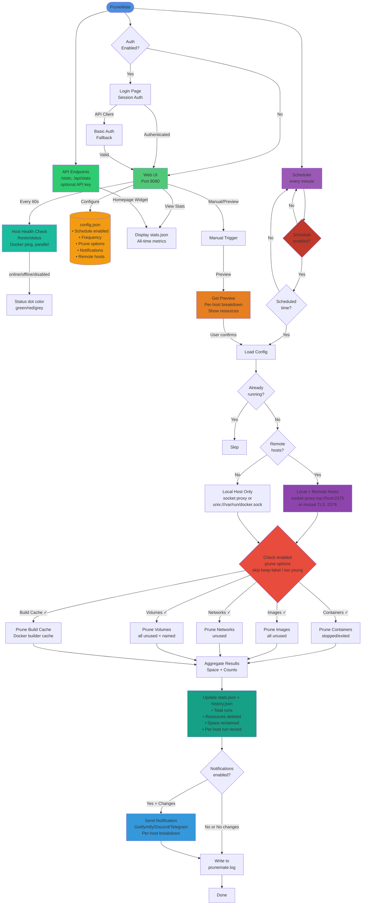
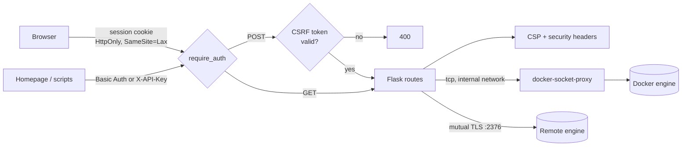

# PruneMate Architecture & Design

This document provides a detailed visual representation of PruneMate's internal architecture and workflow.

## System Architecture



## Component Descriptions

### Core Components

- **Web UI (Port 8080)**: Flask app served by Gunicorn (1 worker, 4 threads). The page is static HTML;
  all behaviour lives in `static/js/app.js`, which talks to the JSON endpoints below via `fetch()`.
- **Scheduler**: APScheduler heartbeat every minute that checks whether the schedule is enabled and due
  - Can be disabled via the "Enable automatic schedule" toggle in the UI
  - Respects configured frequency (daily, weekly, monthly; short months run on their last day)
- **API Endpoints**
  - `/stats` & `/api/stats`: Statistics for Homepage/Dashy. Public by default; require `X-API-Key` when `PRUNEMATE_API_KEY` is set
  - `/api/dashboard`: Stats, next run and the last 30 runs for the UI dashboard (authenticated)
  - `/api/logs`: Tail of the log file with secrets redacted (authenticated)
  - `/hosts/status`: Checks enabled external hosts in parallel and returns `online`, `offline` or `disabled` per host
  - `/healthz`: Liveness probe used by the Docker `HEALTHCHECK` (public, returns `ok`)

### Configuration & State

- **config.json**: Persistent configuration including:
  - `schedule_enabled`, frequency, time and day settings
  - Prune options (containers, images, networks, volumes, build cache)
  - Protection rules: `protect_label` (default `prunemate.keep`, empty = off) and `min_age_hours`
  - Notification providers and settings (secrets are never sent back to the browser)
  - Remote Docker hosts (`name`, `url`, `enabled`, optional `tls` certificate folder)
- **stats.json**: Cumulative all-time statistics (space reclaimed, resources deleted, timestamps)
- **history.json**: Last 100 runs with per-host results (feeds the dashboard chart and table).
  On the first V2 start it is reconstructed once from existing V1.x log files (records marked `imported`)
- **secret_key**: Generated session signing key (0600) unless `PRUNEMATE_SECRET` is set
- **prunemate.lock**: File lock to prevent concurrent prune operations
- **last_run_key**: Tracks the last scheduled run to prevent duplicates

All config writes happen under a lock (read-modify-write), so concurrent requests can't overwrite each other.
When `/config` isn't writable the UI shows a banner and saves return an error instead of silently failing.

### Prune Operations

Protection rules are passed to Docker as prune filters (`label!=<protect_label>`, `until=<N>h`) and mirrored by the preview.

- **Containers**: Removes stopped/exited/dead/created containers
- **Images**: Removes ALL unused images (not just dangling) using `filters={"dangling": False}`
- **Networks**: Removes custom networks not used by any container (running or stopped)
- **Volumes**: Removes ALL unused volumes including named volumes using `filters={"all": True}`.
  Manual runs only prune volumes after the user typed `DELETE`; otherwise volumes are skipped for that run
- **Build Cache**: `docker builder prune` behaviour: unused cache that isn't shared with an existing image

### Multi-Host Support

- **Local Host**: `PRUNEMATE_DOCKER_HOST` (default `unix:///var/run/docker.sock`; recommended `tcp://socket-proxy:2375`)
- **Remote Hosts**: docker-socket-proxy at `tcp://host:2375`, or mutual TLS at `tcp://host:2376`
  with certificates from `/certs/<folder>/{ca,cert,key}.pem` (server certificate and host name are verified)
- **Per-host Results**: Separate statistics and error handling for each host
- **Health Check**: Remote connections are verified with a Docker ping (5s connect timeout, 60s afterwards for operations)
  - The UI polls `/hosts/status` every 60 seconds and colors each host's status dot: green (online), red (offline), grey (disabled), amber (checking/unavailable)

### Notification Flow

- **Providers**: Gotify (self-hosted), ntfy.sh (pub-sub), Discord (webhooks), or Telegram (Bot API)
- **Authentication**:
  - Gotify: App token, sent as `X-Gotify-Key` header
  - ntfy: Bearer tokens, Basic Auth (`user:pass@host`), or unauthenticated
  - Discord: Webhook URLs
  - Telegram: Bot Token + Chat ID (message content is HTML-escaped)
- **Priority System**: Text-based (Low/Medium/High) with provider-specific behavior
  - Gotify: Numeric mapping (Low=2, Medium=5, High=8)
  - ntfy: Numeric mapping (Low=2, Medium=3, High=5)
  - Discord: Color mapping (Low=Green, Medium=Orange, High=Red)
  - Telegram: Notification sound (Low=Silent, Medium/High=Sound)
- **Smart Notifications**: Optional "only on changes" mode to reduce noise
- **Per-host Breakdown**: Compact plain-text results (no emojis) listing only items that were pruned
  - Totals across hosts are omitted when only one host had deletions

## Workflow Explanation

1. **Trigger Sources**:
   - Scheduled: Minute-based scheduler checks if current time matches configured schedule
   - Manual: User clicks **Preview & run** and confirms in the preview dialog

2. **Preview Mode** (Manual only):
   - Unsaved settings are saved first (the user is asked)
   - Queries each enabled Docker host for resources that would be pruned, honoring protection rules
   - Shows per-host lists plus how many resources are protected
   - Volumes require typing `DELETE` before the run can start

3. **Execution**:
   - Acquires file lock to prevent concurrent runs
   - Loads latest configuration from disk
   - Connects to local and remote Docker hosts
   - Executes enabled prune operations per host with protection filters
   - Aggregates results across all hosts

4. **Post-Execution**:
   - Updates cumulative statistics in `stats.json` and appends a run record to `history.json`
   - Sends notifications if enabled (respects "only on changes" setting)
   - Logs detailed results with timezone-aware timestamps (secrets redacted)
   - Releases file lock

## Security model



- **Secret key**: `PRUNEMATE_SECRET` or a random key persisted in `/config/secret_key` (0600).
- **Sessions**: expire after `PRUNEMATE_SESSION_HOURS`; a fresh session (and CSRF token) is issued at login.
- **Brute force**: in-memory sliding window per client IP (`PRUNEMATE_LOGIN_MAX_ATTEMPTS`, `PRUNEMATE_LOGIN_LOCKOUT_MINUTES`).
- **Secrets**: never rendered into HTML; empty form fields keep the stored value; redacted in log output.
  The log viewer also masks secrets in lines written by older versions.
- **Frontend**: `static/js/app.js` builds DOM with `textContent` only; CSP forbids inline scripts/styles.
- **Container**: read-only root filesystem, `no-new-privileges`, `cap_drop: ALL`, gunicorn control socket disabled.

## File Structure

```
/config/
├── config.json          # User configuration (persistent)
├── stats.json           # All-time statistics (cumulative data)
├── history.json         # Last 100 runs with per-host results
├── secret_key           # Generated session signing key
├── prunemate.lock       # Prevents concurrent runs
└── last_run_key         # Tracks last scheduled run

/certs/                  # Optional, read-only: TLS client certificates per remote host
└── <folder>/{ca,cert,key}.pem

/var/log/
└── prunemate.log        # Application logs (rotating, 5MB x 4 files)
```

---

For more information, see the main [README.md](README.md).
